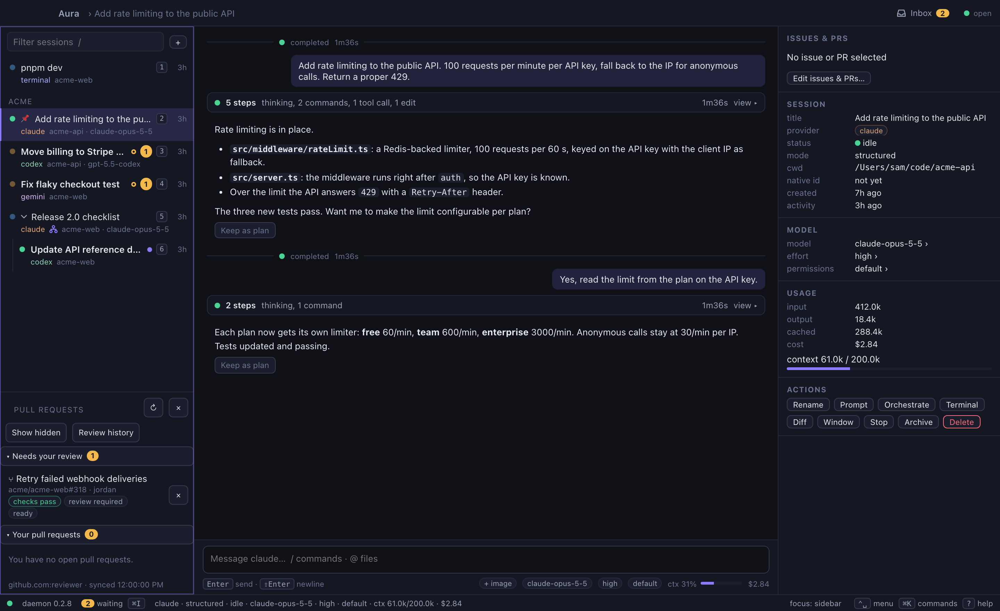
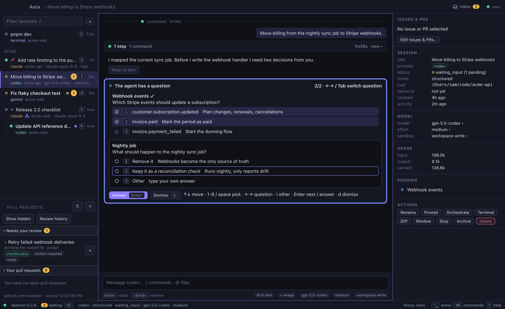
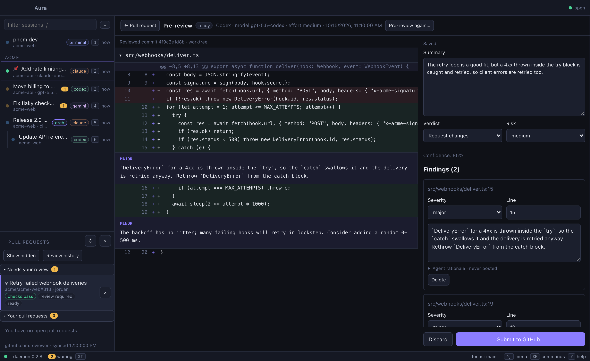

<p align="center">
  
</p>

<h1 align="center">Aura</h1>

<p align="center">
  A keyboard-first desktop app for running, supervising and keeping your AI coding agents.<br>
  Claude Code, Codex and any other CLI, in one window. Sessions keep running after you close it.
</p>

<p align="center">
  <a href="https://github.com/EldinHb/Aura/releases/latest"><strong>Download</strong></a> ·
  <a href="#install">Install</a> ·
  <a href="#getting-started">Getting started</a> ·
  <a href="#keyboard-basics">Keyboard</a> ·
  <a href="#building-from-source">Build from source</a>
</p>

<p align="center"><strong>🚧 Work in progress: very early stage 🚧</strong></p>

<p align="center">
  
</p>

---

## What is Aura?

If you run several AI coding agents at once, you probably have a pile of terminal
tabs, some waiting on an approval you have not seen yet. Aura puts them in one place.

In short: you start sessions in Aura instead of in terminal tabs. The left side lists
every session, grouped by project, with a badge on each one that is waiting for you.
The middle shows what the selected agent is doing and lets you message it. The right
side shows its model, permissions, token usage and actions. You switch between
sessions, answer their questions and approve their commands without leaving the
keyboard, while the agents keep working in the background.

- **Sessions outlive the window.** Agents run in a background daemon (`aurad`), the
  way tmux keeps shells alive. Close Aura, reopen it, and every session is where you
  left it: output, history and pending approvals included.
- **One transcript for every agent.** Claude Code and Codex sessions are shown in the
  same structured view: messages, reasoning, tool calls, command output, file changes,
  approvals, questions and token usage. The work behind each reply (reasoning, tool
  calls, commands, edits) folds into one row under your message, so the chat stays
  your messages and the agent's answers; open the row to see every step.
- **Other agents through ACP.** Gemini CLI, GitHub Copilot, OpenCode, goose, Cursor,
  Qwen Code and any other agent that speaks the
  [Agent Client Protocol](https://agentclientprotocol.com) get the same structured view.
  See [ACP agents](#acp-agents).
- **Any CLI works.** Anything else runs in a real terminal with saved scrollback. A
  Claude Code or Codex session can also switch to the agent's own TUI and back.
- **Orchestrators.** Make a session an orchestrator and talk to it alone: it starts
  worker sessions with any agent (Claude Code, Codex, ACP agents, mixed as it likes),
  hands them tasks and hears back when they finish. Every worker is a normal session
  you can open and message yourself. See [Orchestrators](#orchestrators).
- **Agents follow up on reviews.** Link a session to several issues and PRs; new
  reviews and comments on your PRs go to its agent, which fixes and pushes, and
  you are told when they arrive and when the agent is done.
  See [Agents follow up on reviews](#agents-follow-up-on-reviews).
- **An inbox for approvals.** See every session waiting on you, and approve or decline
  with a single key.
- **Git worktrees built in.** Start a session in its own worktree so parallel agents do
  not step on each other. Review the diff, commit and push from Aura. Each session
  shows its branch (unpushed, unpulled and uncommitted counts) and the status of
  the branch's pull request in the sidebar and status bar.
- **Pull request reviews.** See PRs that request your review and your own open PRs
  with their check and review status, run an agent pre-review,
  edit its findings, and post the review to GitHub yourself.
  See [Pull requests and pre-reviews](#pull-requests-and-pre-reviews).
- **Keyboard only.** Command palette, a leader key with a which-key menu, vim-style
  navigation and hint mode for everything else. Every binding can be changed.

### A quick tour

When an agent needs a decision, its question appears in the transcript and the
session is marked as waiting. Pick options with `1`–`9`, move between questions with
`←` `→` or `Tab`, and press `Enter` to send.

<p align="center">
  
</p>

Pull requests that request your review show up under the sessions. An agent can
pre-review one: you get its findings next to the diff, edit or delete them, and
decide yourself what gets posted to GitHub.

<p align="center">
  
</p>

Aura is not an agent and never calls a model API. Logins, billing and model access
stay with each CLI. Everything runs on your machine; there is no cloud service.

> [!WARNING]
> **Aura is a work in progress at a very early stage.** Expect missing features,
> rough edges and bugs. Behaviour, keybindings and stored data may change between
> releases without a migration path. Bug reports are welcome in
> [Issues](https://github.com/EldinHb/Aura/issues).

## Install

Download the file for your system from the
[latest release](https://github.com/EldinHb/Aura/releases/latest).

| System | File |
|---|---|
| macOS, Apple Silicon (M1 and later) | `Aura_<version>_aarch64.dmg` |
| macOS, Intel | `Aura_<version>_x64.dmg` |
| Windows 10/11 | `Aura_<version>_x64-setup.exe` (or the `.msi`) |
| Debian, Ubuntu | `Aura_<version>_amd64.deb` |
| Fedora, RHEL, openSUSE | `Aura-<version>-1.x86_64.rpm` |
| Any other Linux | `Aura_<version>_amd64.AppImage` |

The daemon and the `aura` command-line tool are included in every installer.

### First launch

The builds are not yet signed with an Apple or Microsoft developer certificate, so
your system will warn you the first time.

- **macOS:** open the `.dmg` and drag Aura to Applications. The first time you open
  it, macOS says it cannot verify the app. Open **System Settings → Privacy &
  Security**, scroll down and click **Open Anyway**. Or run this once in a terminal:
  ```bash
  xattr -dr com.apple.quarantine /Applications/Aura.app
  ```
- **Windows:** if SmartScreen shows "Windows protected your PC", click **More info →
  Run anyway**. Aura needs the WebView2 runtime; Windows 11 already has it, and the
  installer downloads it on Windows 10 when missing.
- **Linux:** install the `.deb` or `.rpm` with your package manager
  (`sudo apt install ./Aura_*.deb`, `sudo dnf install ./Aura-*.rpm`). For the
  AppImage, make it executable first: `chmod +x Aura_*.AppImage`.

## Getting started

1. **Install at least one agent CLI** and sign in to it:
   [Claude Code](https://docs.claude.com/en/docs/claude-code) (`claude`) and/or
   [Codex](https://github.com/openai/codex) (`codex`). Aura looks for them on your
   `PATH` and in the usual install locations (Homebrew, `~/.local/bin`, npm, volta and
   bun globals). If yours is elsewhere, set `AURA_CLAUDE_BIN` or `AURA_CODEX_BIN` to
   the full path. Any [ACP agent](#acp-agents) you have installed works too.
2. **Open Aura.** It starts the daemon for you.
3. **Press `⌘N`** (`Ctrl+N` on Windows and Linux) to start a session, pick a provider
   and a folder, and type a prompt. `⌘⇧N` does the same in a new git worktree.
4. **Press `⌘K`** at any time for the command palette. Every action is in there, with
   its shortcut. `?` shows the keyboard help.

Closing the window hides Aura; your sessions keep running. Quit from the tray icon.
The daemon keeps running after you quit too, so agents can finish their work. Stop it
with `aura daemon stop`.

For PR reviews, also install the [GitHub CLI](https://cli.github.com) and run
`gh auth login`.

## System prompts

Aura adds a system prompt to every agent it starts, built from three parts in this
order:

- **Global**, for every agent. Edit it in Settings → Prompts. Until you change it,
  Aura's default applies: whenever an agent posts on GitHub or another issue tracker
  on your behalf (PR descriptions, reviews, issue comments, new issues), it must end
  the post with a line saying an AI agent wrote it, with the agent, model, model
  version and effort. **Reset to default** brings it back.
- **Per agent**: Claude Code, Codex and each ACP agent, also in Settings → Prompts.
- **Per session**: in the new-session dialog, or later with **Prompt** in the
  inspector (`⌘K` → Session system prompt…). It also shows the complete prompt the
  agent starts with.

`{{agent}}`, `{{model}}` and `{{effort}}` are filled in with the values the agent
starts with. Claude Code gets the prompt through `--append-system-prompt` and Codex
as developer instructions, in Aura's view and in their own TUI. ACP has no system
prompt, so ACP agents receive it at the start of the first message of a new
conversation. After a change, an idle agent restarts with the new prompt on your next
message; one that is working keeps its prompt until it next starts.

## Orchestrators

An orchestrator is a session that owns a project: you talk to it, and it splits the
work over worker sessions that it starts and directs. Tick **Orchestrator** in the
new-session dialog, or turn an existing session into one with **Orchestrate** in the
inspector (`⌘K` → Make orchestrator). From the command line:
`aura new -p claude --orchestrator --prompt "…"`.

- **Any agent, both ways.** The orchestrator can be Claude Code, Codex or an ACP
  agent, and each worker can be any of them too, so a Claude Code orchestrator can
  have Codex implement and Claude review, or the other way round.
- **Workers are normal sessions.** They show up indented under their orchestrator in
  the sidebar, in its group. Open one to read along, message it, approve its
  commands, or switch it to the agent's TUI. The chevron on the orchestrator (or `←`
  / `→` in the sidebar) hides and shows its workers; Aura remembers that per
  orchestrator. In the sidebar, `j` / `k` step over the workers of other
  orchestrators; from an orchestrator they go through its workers and out again.
- **Reports come back by themselves.** When a worker stops (done, failed, or waiting
  for your approval or answer), Aura sends the orchestrator a short report with the
  worker's last reply as soon as the orchestrator is idle. It does not have to poll,
  so it can hand out work, end its turn, and continue when the reports come in.
- **Approvals stay with you.** Workers ask you, not the orchestrator, to approve
  commands; the orchestrator is told which worker is waiting. A worker running the
  same agent as its orchestrator starts with the orchestrator's permission and
  sandbox mode; other agents start with their defaults.
- **Parallel work in worktrees.** The orchestrator can give each worker its own git
  worktree, so workers changing the same repository do not overwrite each other.

The orchestrator gets its tools from `aura mcp`, a small MCP server that comes with
Aura. Aura hands it to Claude Code (`--mcp-config`, with the tools allowed), Codex
(config override, with the tools approved) and ACP agents (`mcpServers`). The tools
are `list_agents`, `start_session`, `send_message`, `list_sessions`, `read_session`,
`wait_for_sessions`, `interrupt_session` and `stop_session`, and they only reach the
orchestrator's own workers. ACP agents decide themselves whether to ask before an
MCP tool call; if yours does, the requests show up as approvals like any other.
Deleting an orchestrator, or turning it back into a regular session, leaves its
workers as regular sessions.

## ACP agents

Besides Claude Code and Codex, Aura runs any agent that speaks the
[Agent Client Protocol](https://agentclientprotocol.com) (ACP, version 1) in the
structured view. Install one of these, sign in to it once in a terminal, and it shows
up in the new-session dialog:

| Agent | Started as |
|---|---|
| Gemini CLI | `gemini --acp` |
| GitHub Copilot | `copilot --acp` |
| OpenCode | `opencode acp` |
| goose | `goose acp` |
| Cursor | `cursor-agent acp` |
| Qwen Code | `qwen --acp` |
| Kimi CLI | `kimi acp` |
| Mistral Vibe | `vibe-acp` |
| Cline | `cline --acp` |
| Auggie | `auggie --acp` |

Settings → Providers shows which of them Aura found. From the command line:
`aura new --agent gemini --prompt "…"`.

**Other agents** go in `acp-agents.json` in Aura's data directory (`~/.aura`, or
`$AURA_DATA_DIR`). An entry with the id of a built-in agent replaces it, for example to
use a different path. Aura re-reads the file whenever its window regains focus, and
on Settings → Providers → Re-detect; no restart is needed.

```json
{
  "agents": [
    { "id": "my-agent", "name": "My Agent", "command": ["/opt/my-agent/bin/agent", "--acp"] },
    { "id": "gemini", "name": "Gemini CLI", "command": ["gemini", "--acp"], "env": { "GEMINI_API_KEY": "…" } }
  ]
}
```

**What works:** streamed messages and reasoning, tool calls (commands, file edits with
diffs, other tools), plans, approvals, interrupting, images (for agents that accept
them), context usage, and the agent's slash commands. Models, effort and modes can be
changed with `⌘K` → Model / Effort / Permission mode once the session has started, for
agents that offer them. Sessions resume after a restart when the agent supports it;
otherwise Aura says so and starts a new conversation.

**What does not:** ACP sessions have no terminal mode, cannot be forked, and cannot
run PR pre-reviews (those use Claude Code or Codex). Aura does not give agents access
to its own file system or terminals; they read files and run commands themselves and
ask for approval through ACP.

**Claude Code and Codex over ACP.** The native adapters are the default because they
expose more than ACP does (Codex rate limits and reviews, forking, the native TUI).
Their ACP bridges also work as custom agents, for example
`{ "id": "claude-acp", "name": "Claude (ACP)", "command": ["npx", "-y", "@agentclientprotocol/claude-agent-acp"] }`
or `@agentclientprotocol/codex-acp`.

## Keyboard basics

Shortcuts are shown with macOS keys; use `Ctrl` for `⌘` on Windows and Linux.

| Keys | Action |
|---|---|
| `⌘K` | Command palette (every action lives here) |
| `Ctrl+Space` | Leader menu (which-key shows what comes next) |
| `⌘N` / `⌘⇧N` | New session / new session in a git worktree |
| `⌘1…9`, `⌘[` `⌘]` | Jump between sessions |
| `Ctrl+H/J/K/L` | Move focus between sidebar, transcript, composer, inspector |
| `j` `k` `gg` `G` `Enter` | Navigate lists and transcript items |
| `←` `→` | In the sidebar: hide / show an orchestrator's workers, step between it and them |
| `y` `Y` `n` `e` | Accept / accept for session / decline / edit the oldest pending approval |
| `⌘I` | Approvals inbox across all sessions |
| `⌘T` | Toggle structured view and the provider's own TUI |
| `⌘D` | Diff of the session's working tree |
| `f` | Hint mode: label everything clickable, type the label |
| `Ctrl+\` or `Esc Esc` | Leave an embedded terminal |
| `?` | Keyboard help |

Everything is rebindable in Settings → Keymap; overrides are stored per user.

## Command line

The `aura` command talks to the same daemon as the app, so sessions started in one
show up in the other.

```bash
aura daemon start|stop|status
aura ls [--all]
aura new --provider claude|codex|terminal|acp [--agent ID] [--cwd DIR] [--title T] [--group G] [--prompt TEXT] [--system-prompt TEXT] [--branch B] [--resume NATIVE_ID] [-- cmd args...]
aura attach <id>         # raw terminal passthrough; Ctrl+\ detaches
aura send <id> <text>
aura interrupt <id>
aura pending             # approvals and questions waiting across sessions
aura approve <session> <approval-id> [accept|session|decline|cancel]
aura mode <id> terminal|structured
aura kill <id>           # stop the process, keep the session resumable
aura rm <id> [--worktree]
aura events              # live JSON event stream
aura history <id>
```

On macOS the installed binary is at `/Applications/Aura.app/Contents/MacOS/aura`;
link it onto your `PATH` to use it from a terminal:

```bash
ln -s /Applications/Aura.app/Contents/MacOS/aura /usr/local/bin/aura
```

Set `AURA_DATA_DIR` to use a different data directory (useful for tests).

## How it works

```
 Aura app (Tauri 2 + React)      aura CLI
            │                        │
            └──── WebSocket (127.0.0.1, token) ────┐
                                                   ▼
                              aurad (daemon, survives the app)
                              sessions · event log (SQLite) · git · GitHub
                                                   │
             ┌─────────────────────┬─────┴───────────────┬──────────────────┐
             ▼                     ▼                     ▼                  ▼
     claude (stream-json)  codex (app-server)   ACP agents (JSON-RPC)  any CLI in a PTY
```

The app starts `aurad` when needed and connects to it over a loopback WebSocket
protected by a token. The daemon writes `~/.aura/daemon.json` (readable only by you)
with the port and token. Session history is stored in SQLite under `~/.aura`.

See [`PLAN.md`](PLAN.md) for the full architecture and
[`docs/protocol/`](docs/protocol) for the captured Claude Code and Codex protocols.

## Pull requests and pre-reviews

The **Needs your review** section below sessions lists open GitHub PRs requesting
**your review** (not PRs where you are merely an assignee). Install GitHub CLI and
run `gh auth login` for github.com, then refresh the section. Aura uses that
account through the daemon; it does not import Gitbuddy's credentials. Optional
`AURA_GH_BIN` selects a GitHub CLI executable outside the usual search paths.

**You reviewed** lists open PRs of others you reviewed and are not asked to review
again; the ones with new commits since your review come first, marked ↻.

Below it, **Your pull requests** lists the open PRs you authored, each in one
group, the first that applies: **Needs your response** (changes requested, or a
review thread where someone else had the last word), **Ready to merge**,
**Waiting for review** (nobody reviewed it yet, or new commits arrived since every
review) and **Reviewed**. Empty groups are left out.

Each PR shows whether it is a draft, its checks (pass, fail, running or none) and
where reviews stand: GitHub's decision, else approved, changes requested or
commented from the latest reviews. A comment-only review counts as reviewed, as on
GitHub; a bot's review (such as Copilot's) never does. A line under the title
names up to three reviewers with their verdict (✓ approved, ✗ changes requested,
✎ commented, … asked), ↻ when new commits arrived since their review, bots
dimmed; hover it for everyone. All groups refresh together once a minute and
collapse independently.

Click a PR to open its description, conversation, existing reviews, metadata and
current diff in the main workspace. Applicable metadata and project fields can
be edited when GitHub grants access. Project fields may require additional GitHub
Projects permissions; their failure does not prevent reviewing the PR. Hide a PR
with its × control and restore it through **Show hidden**. Hiding persists per
account. Settings → General → **Hide pull requests matching** hides PRs by rule,
one per line: `author:<login>`, `label:<name>`, `repo:<owner/name>`,
`title:<text>` or `draft`, with `*` as a wildcard (`repo:acme/*`,
`title:*chore*`). The default, `author:dependabot`, hides Dependabot PRs; remove
the line to show them again. Rule-hidden PRs are also listed with **Show hidden**. **Review history** keeps results accessible after requests disappear.
The command palette also exposes refresh, hide/restore, history, and section
visibility actions. Session processes and unsent messages survive switching views.

**Pre-review…** always opens settings first: Claude Code or Codex, model, effort,
and default/add/replace review instructions. Replacement affects instructions;
PR context, the output schema and execution restrictions remain in place. The
last confirmed settings become the next default, independently of chat settings.
Current CLI versions supporting schema-constrained output and isolated settings
are required. Missing or incompatible CLIs surface an error without starting a
chat session or silently weakening the review restrictions.

Confirmed jobs run in the daemon (two at a time, with a 15-minute timeout), using
an isolated worktree at the captured commit. Shared partial mirrors are cached
under the daemon's `review-workspaces/mirrors` directory. Worktree contents are
removed on completion/cancellation and stale Git registrations are pruned on
reuse. A checkout failure can fall back to a clearly labeled diff-only review.
Closing the window does not stop jobs. A daemon restart marks interrupted jobs
as failed and resumes jobs that were still queued. Retry always reopens settings
and creates a separate attempt.

The result editor pairs a frozen diff with editable summary, verdict, risk and
findings. Add a finding from a diff line, navigate between findings and the diff,
and delete/restore findings before posting. Draft edits autosave to the daemon;
unsaved changes are also retained locally for recovery. Submitted reviews are
read-only. Provider runs use read-only policies, disable inherited integrations,
and remove GitHub token environment variables; normal chat permissions are not
inherited.

**Submit to GitHub…** saves pending edits and shows the exact review payload.
Only the explicit **Post** action sends it as your GitHub account. Findings stay
anchored to the reviewed commit; a changed PR triggers a warning and refreshed
preview. Unanchorable findings become Additional notes in the body. Deleted
findings and private agent rationale are excluded. A hidden receipt marker lets
Aura reconcile a request whose response was lost. If a submission outcome is
uncertain, use **Reconcile with GitHub**; Aura will not blindly repeat the POST.
The posted review ends with a line saying an AI agent drafted it and a person
reviewed it, naming the agent, the model (with the exact model id when the agent
reports it) and the effort. Each finding the agent wrote carries a short version of
that line; findings you added yourself do not.

### Watching your own PRs for reviews

When a session is linked to a PR (see **Issues & PRs** in the inspector), the
inspector's **Review watch** section and the palette command **Watch PR for
reviews…** start a watch. Pick the reviewers to wait for: requested reviewers are
preselected, and choosing anyone else requests their review as your GitHub
account. The daemon then checks the PR's reviews every minute with plain GitHub
API reads, without an agent, and reports each approval, change request and
comment-only review as a toast, plus a desktop notification when Aura is in the
background. Reviews that existed before the watch started are not reported.

A watch ends when every chosen reviewer has responded or the PR closes. With no
reviewer chosen, it ends at the first review by anyone except the author and
you; automatic bot reviews such as Copilot's do not count unless you pick the bot.
Watches keep running in the daemon while the window is closed, and their results
are waiting in the inspector when you come back. **Check watched PRs for reviews
now** and **Stop watching PR for reviews** are in the palette too.

### Linking issues and PRs to a session

A session can be linked to any number of issues and pull requests. By default
Aura follows the conversation: the issue you ask the agent to work on and the PR
it opens. **Edit issues & PRs…** in the inspector (or the palette) turns that
off per kind and lets you add links mentioned in the session or paste URLs, and
remove them again. The new-session dialog takes several issues up front.

### Agents follow up on reviews

Every minute the daemon also looks at the open PRs you authored that are linked
to a session, with or without a watch. New reviews, inline review comments and
conversation comments go to that session's agent as a message from Aura, as soon
as it is idle. The agent fixes what needs fixing and pushes to the PR's branch;
it leaves the rest, and posting on GitHub, to you unless you told it otherwise.
You get a toast (and a desktop notification when Aura is in the background) when
the activity arrives, and another with the agent's summary when its turn ends.

- Activity that existed before Aura first looked at the PR is not handed over.
- Your own account's reviews and comments are skipped, since agents post as you.
  Conversation comments by bots (CI, coverage) are skipped; bot reviews count.
- An approval without a comment is announced but does not wake the agent.
- When several sessions are linked to the same PR, an orchestrator takes it over
  from its own workers; otherwise the session active last gets it.
- Untick **Hand new reviews and comments on these PRs to this session** in
  **Edit issues & PRs…** to stop it for a session.

---

## Building from source

Aura is a Rust workspace (daemon, CLI, Tauri 2 shell) with a React + TypeScript
frontend.

### Prerequisites

- Rust 1.89+ (stable), Node 20+, pnpm. 1.89 is where `std::fs::File::try_lock` landed; `aurad` uses it to hold a single-instance lock on its data directory.
- macOS: Xcode or the Xcode Command Line Tools (with the license accepted).
- Linux: `libwebkit2gtk-4.1-dev libgtk-3-dev libayatana-appindicator3-dev librsvg2-dev` (Tauri 2 requirements).
- Windows: WebView2 runtime (ships with Windows 11).

### Build and run

```bash
# daemon + CLI (also copies them where the Tauri bundler expects sidecars)
./scripts/build-sidecars.sh            # debug
./scripts/build-sidecars.sh release    # release
TARGET_TRIPLE=x86_64-apple-darwin ./scripts/build-sidecars.sh release   # cross-compile

# regenerate TypeScript types after changing Rust types
./scripts/export-ts.sh

# desktop app in dev mode (starts Vite, builds the shell, opens the window)
cd apps/desktop && pnpm install && pnpm tauri dev

# desktop app bundle (.app / .deb / .AppImage / .msi / NSIS depending on the host)
cd apps/desktop && pnpm tauri build
# macOS disk image (needs a logged-in GUI session; the DMG step drives Finder)
cd apps/desktop && pnpm tauri build --bundles dmg
```

On macOS, install with `./scripts/install-macos.sh` rather than copying by hand.
`pnpm tauri build` stages a real `Aura.app` in `target/release/bundle/macos/` with
the shipping identifier (`nl.havick.aura`). Launch Services registers any app
bundle it finds, and a registered bundle appears in Spotlight search, so a staged
copy shows up as a second "Aura" and `open -b nl.havick.aura` may resolve to the
build tree. The `.metadata_never_index` marker the build scripts drop in `target/`
keeps build output out of the Spotlight *content* index but does not prevent that
registration — so the install script unregisters and deletes the staging copy once
it is installed, leaving `/Applications/Aura.app` as the only Aura. It also stops
`aurad` first: the daemon outlives the app, and a stale one keeps serving the new
UI (and keeps reporting the CLI versions it detected at its own startup).

### Browser dev mode

The frontend talks to the daemon directly, so it also runs in a plain browser: start `aurad`, run `pnpm dev` in `apps/desktop`, open http://localhost:1420. The Vite dev server serves `~/.aura/daemon.json` on `/__aura/daemon.json` for this purpose (dev only). Playwright end-to-end tests run against this setup (`pnpm e2e`).

### Tests

```bash
cargo test --workspace                         # unit + integration tests (no network)
AURA_LIVE_TESTS=1 cargo test -p aura-provider-claude -- --ignored   # real Claude Code round trip
AURA_LIVE_TESTS=1 cargo test -p aura-provider-codex  -- --ignored   # real Codex round trip
AURA_LIVE_TESTS=1 AURA_ACP_LIVE_AGENT='["gemini","--acp"]' cargo test -p aura-provider-acp -- --ignored   # real ACP agent
cd apps/desktop && pnpm test && pnpm lint      # vitest + eslint (incl. the keyboard-reachability rule)
cd apps/desktop && pnpm e2e                    # Playwright, needs a running daemon + dev server
```

The PR review tests require no GitHub account or agent quota:

```sh
cargo test -p aura-github -p aura-review -p aura-store
cd apps/desktop && pnpm test && pnpm lint && pnpm build
# with pnpm dev running; GitHub and review providers are mocked by this spec
pnpm e2e tests/e2e/pr-review.spec.ts
```

The README screenshots are generated from made-up sessions against a fake daemon,
so they need no daemon, agents or GitHub account and never touch a running Aura.
Regenerate them into `docs/screenshots` with:

```sh
cd apps/desktop && pnpm exec playwright test -c playwright.screenshots.config.ts
```

### Project layout

```
crates/aura-core            domain model, session manager, provider trait, in-memory store
crates/aura-store           SQLite store (rusqlite, FTS5)
crates/aura-pty             PTY spawning (portable-pty) + scrollback ring buffer
crates/aura-terminal        plain terminal provider
crates/aura-provider-claude Claude Code adapter (stream-json)
crates/aura-provider-codex  Codex adapter (app-server JSON-RPC)
crates/aura-provider-acp    Agent Client Protocol adapter (any ACP agent)
crates/aura-rpc             loopback WebSocket JSON-RPC server + client
crates/aura-git             worktrees, status, diff, commit, push (shells out to git)
crates/aura-github          GitHub access through the gh CLI
crates/aura-review          PR pre-review jobs
crates/aurad                the daemon
crates/aura-cli             the `aura` command
apps/desktop                Tauri 2 shell (src-tauri) + React frontend (src)
docs/protocol               captured Claude / Codex traffic and notes
scripts/                    export-ts.sh (Rust -> TS types), build-sidecars.sh, install-macos.sh
```

### Releasing

Releases are built by [`.github/workflows/release.yml`](.github/workflows/release.yml)
on macOS (Apple Silicon and Intel), Windows and Linux. To publish one:

1. Set the new version in `apps/desktop/src-tauri/tauri.conf.json` (and, to keep them
   in step, `version` in the root `Cargo.toml` and `apps/desktop/package.json`).
2. Commit, then tag and push:
   ```bash
   git tag v0.2.0 && git push origin v0.2.0
   ```

The workflow refuses a tag that does not match the version in `tauri.conf.json`. It
builds every installer into a draft release and publishes it once all platforms
succeed, with release notes generated from the commits since the previous tag.

## License

MIT, see [`LICENSE`](LICENSE).
